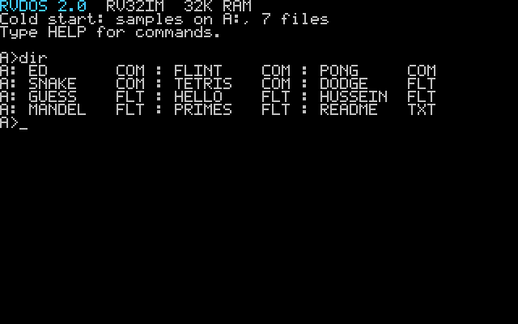
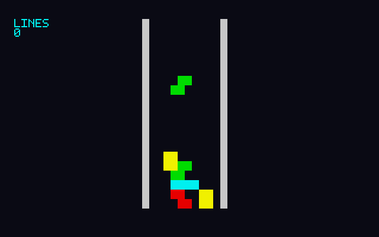

# RV32IM CPU + RVDOS + Flint

A RISC-V computer built from the ground up: a pipelined RV32IM CPU written
in VHDL, a CP/M-style operating system (RVDOS) that runs on it, and Flint,
a small programming language built into the OS. It runs on a Digilent
Basys3 FPGA board with a VGA monitor and a USB keyboard, and in an
emulator on your PC.

| | |
|---|---|
|  |  |
|  |  |

## What's in it

- **CPU**: 5-stage pipelined RV32I + M (multiply; divide is done in
  software), with forwarding and hazard detection. 320×200 framebuffer with
  a 256-colour palette, VGA output at 640×480, a PS/2-style keyboard port.
- **RVDOS**: boots to an `A>` prompt with CP/M commands (`DIR`, `TYPE`,
  `REN`, `PIP`, `ERA`, ...), a RAM disk that survives the reset button, a
  full-screen editor (`ED`), and Snake, Tetris and Pong.
- **Flint**: a Lua-like language with functions, arrays, graphics and
  keyboard input. Write programs in `ED`, save them as `.FLT`, run them by
  name. Its parser comes from [gram](https://github.com/Husseinabdulameer11/gram).
- **Tools**: an assembler, an emulator (with a headless mode for tests),
  and a script that copies files to and from the emulator's disk.

## Layout

```
hw/         the CPU and the Basys3 board design (VHDL), hw/build.tcl for Vivado
hw/sim/     testbenches and the program images they load
os/         RVDOS, Flint, the editor and the games (C); os/samples/ are the
            programs copied to A: on a cold start
tools/      assembler, emulator, disk tool, font generator
tests/      emulator tests, Flint tests, VHDL testbench runner
demos/      the bare-metal programs from before the OS existed
docs/       CPU.md (ISA, memory map, design notes), RVDOS.md, FLINT.md
gram/       the parser library (git submodule)
```

## Getting started

Clone with the submodule:

```
git clone --recursive https://github.com/Husseinabdulameer11/<this-repo>
```

(Already cloned without it? Run `git submodule update --init`.)

### Run it in the emulator

Needs gcc and SDL2. On Windows use MSYS2 (`pacman -S mingw-w64-ucrt-x86_64-gcc
mingw-w64-ucrt-x86_64-SDL2`); on Linux, `gcc` and `libsdl2-dev`.

```
./run.sh            # RVDOS at the board's 25 MHz
./run.sh --fast     # as fast as your PC goes
```

Drive A: is saved in `rvdos.disk`. Delete it to get a cold start with fresh
samples. To copy a program you wrote on your PC onto it:

```
python3 tools/rvdisk.py rvdos.disk put MYGAME.FLT
```

### Put it on a Basys3

Needs only Vivado (tested with 2023.2). The OS image is already built in `os/`.

1. Connect the board with a micro-USB **data** cable, a monitor to the VGA
   port, and a USB keyboard to the USB port next to it.
2. From the repo root:
   ```
   vivado -mode batch -source hw/build.tcl
   ```
   or, in the Vivado Tcl shell, `source hw/build.tcl`. It builds
   `build/rvdos.bit` (about 5 minutes) and programs the board.

The keyboard layout is Norwegian; set `KBD_LAYOUT` to `"US"` in
`hw/basys3_top.vhd` for a US keyboard. The board forgets the design at
power-off, so program it again after switching on.

### Change the OS

Needs the RISC-V cross compiler `riscv64-unknown-elf-gcc` (Debian/Ubuntu
package `gcc-riscv64-unknown-elf`) and a host gcc.

```
os/build_os.sh      # rebuilds os/rvdos_text.hex and os/rvdos_rodata.hex
```

Any `.FLT` file you add to `os/samples/` becomes a built-in program. After
rebuilding, run `./run.sh` or rebuild the bitstream.

## Writing a Flint program

```
A>ED STARS.FLT
```

```
# stars.flt
cls()
for i = 1 to 200
  pixel(rnd(320), rnd(200), 1 + rnd(3))
end
getkey()
```

ESC then X saves; `STARS` runs it. The whole language is in
[docs/FLINT.md](docs/FLINT.md).

## Tests

```
tests/smoke.sh            # every shell command and program, in the emulator
tests/run_flint_tests.sh  # Flint programs against expected output
tests/run_vhdl_tests.sh   # all CPU testbenches in GHDL (~4 min)
tests/ghdl_rvdos.sh       # boots RVDOS on the VHDL CPU and compares the
                          # screen with the emulator's (~10 min)
```

## Documentation

- [docs/CPU.md](docs/CPU.md): the instruction set, memory map, video,
  keyboard, pipeline and FPGA notes
- [docs/RVDOS.md](docs/RVDOS.md): commands, the editor, syscalls, memory
  layout
- [docs/FLINT.md](docs/FLINT.md): the language
